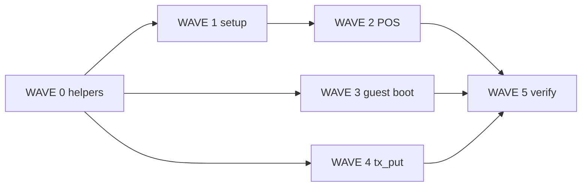

# Site order fulfillment (kitchen / processing) — multitask plan

> **For agentic workers:** REQUIRED SUB-SKILL: Use `subagent-driven-development` or `executing-plans`. One **Task subagent per track** in each wave; parent dispatches parallel tracks, does not implement all lanes inline. Subagent **model: inherit** (see `.cursor/rules/subagent-model.mdc`). Steps use checkbox (`- [ ]`) syntax.

**Goal:** Gate **in-house order processing** (kitchen queue, `pending` lifecycle, guest processing steps) behind a site capability **`order_fulfillment`**, configured at **site create** and **Settings**, while keeping **payment verification** available whenever **`commerce`** is on.

**Architecture:** Extend existing `site.config.capabilities_json` (same pattern as `commerce`, `booking`, `queue`, `attendance`). **Do not** reuse capability key `queue` — that gates **guest waiting-room / ticket queue blocks**, not POS kitchen. Staff POS hides `PosQueueMode.orders` when off; **payment confirm** transitions to **`ok`** instead of **`pending`** when off. Guest boot omits or shortens `order_progress_steps` when off. Server **coerces** illegal `pending` writes when fulfillment is disabled (defense in depth for chat tools and rogue clients).

**Tech stack:** Rust `c35_mod_site`, `c35_mod_tx`, `wire_http`; Flutter `clients/app` Sites/POS/guest_site; static `clients/web/static/site-guest/`; specs `site.md`, `tx.md`, `site-guest-components.md`.

**Specs (read first):** [`spec.md`](../../spec.md) · [`_/specs/site.md`](../site.md) · [`_/specs/tx.md`](../tx.md) · [`_/specs/site-guest-components.md`](../site-guest-components.md)

**Prior art:** POS queues locked in [`tx.md`](../tx.md) § POS open queues; guest progress in [`2026-10-08-site-guest-csa-commerce-parity-multitask.md`](2026-10-08-site-guest-csa-commerce-parity-multitask.md) Wave 3.

---

## Global constraints

- Capability key is exactly **`order_fulfillment`** (snake_case in JSON).
- **Payment verification** (`waiting_payment` → staff confirm) stays under **`commerce`**, not under `order_fulfillment`.
- Money / wire: unchanged `Tx` proto and `guest-order/*` HTTP; only state transitions and UI gating change.
- UTF-8 sources; verify per [`verify-after-edit.mdc`](../../.cursor/rules/verify-after-edit.mdc).
- No new LLM provider grounding; inst changes are factual capability mentions only.
- After server/static ship: `.\_\scripts\deploy\publish_server.ps1` + republish guest renderer if `site-guest.v1.js` changes.

---

## Locked design contract

| Capability | Staff POS | Guest |
|------------|-----------|-------|
| `commerce` | Register, products, payment verification queue | Cart, checkout, `waiting_payment` |
| **`order_fulfillment`** | **Orders / kitchen** queue, Take, Mark done; badge on `pending` | `order_track` **stepper** includes `pending` (“Diproses”); boot `order_progress_steps` full list |
| `commerce` only | No kitchen icon; confirm payment → **`ok`** (+ paid) | Progress: **payment → complete** (no `pending` step in boot / UI) |

**Defaults (backward compatible):**

| Context | `order_fulfillment` when key absent |
|---------|-------------------------------------|
| **Existing** `site.config` rows (migration) | **`true`** if `commerce` is true (preserves live F&B) |
| **New site create** wizard | **`false`** unless user checks new toggle |
| **Settings encode** | Explicit bool in JSON (always persist key once saved) |

Implement absent-key behavior in **`site_order_fulfillment_enabled(caps)`** (Rust + Dart mirror), **not** via global `site_capability_enabled` default-true.

**Copy (English UI):**

- Settings toggle: **Order processing (kitchen)** — subtitle: *Track open orders and guest “being prepared” status. Cashier-only sites can leave this off.*
- Create site: same label; visible when **POS** or **Product** enables commerce; default **unchecked**.

---

## Gap analysis

| Area | Today | Target |
|------|-------|--------|
| Capabilities | `commerce`, `booking`, `queue`, `attendance` | + `order_fulfillment` |
| Site create | `siteCreateFeaturesToCaps` — no fulfillment flag | Checkbox → caps |
| POS app bar | Kitchen + payment always on `posEntry` | Kitchen gated; payment always (if commerce) |
| `confirmPayment` | Always `TX_STATE_PENDING` | `ok` when fulfillment off |
| Guest boot | `order_progress_steps_json()` always 4 steps | 3 steps (no `pending`) or omit key when off |
| Server `tx_put` | Accepts any state | Coerce `pending` → `ok` when fulfillment off |
| Chat `site.tx` tool | Can set `pending` | Document + server coerce |

---

## File map

| File | Responsibility |
|------|----------------|
| `servers/crates/mod_site/src/site_config.rs` | `site_order_fulfillment_enabled(&Value)` |
| `servers/crates/mod_site/src/commerce_boot.rs` | Conditional `order_progress_steps` in boot builders |
| `servers/crates/mod_site/src/site_boot.rs` | Pass caps into step JSON helper |
| `servers/crates/mod_site/src/render.rs` | Published `__SITE_GUEST__.order_progress_steps` |
| `servers/crates/mod_tx/src/tx_put.rs` | Post-`tx_finalize` coercion for sales |
| `servers/crates/mod_tx/tests/` or `mod_site/tests/` | Unit tests for caps + steps |
| `_/schemas/migrations/site_order_fulfillment_v1.sql` | Backfill `order_fulfillment: true` where commerce on |
| `clients/app/lib/c/site/site_table_rows.dart` | `_capabilityKeys`, defaults, `SiteEditorCaps` |
| `clients/app/lib/c/site/site_api.dart` | `SiteCreateFeatures.orderFulfillment` + caps map |
| `clients/app/lib/widgets/sites/in_site_create.dart` | Create wizard checkbox |
| `clients/app/lib/widgets/sites/editor/ui_site_settings_editor.dart` | Settings toggle (under Commerce) |
| `clients/app/lib/widgets/sites/tx/ui_site_tx_editor.dart` | Gate kitchen `IconButton` + skip `orderCount` refresh noise |
| `clients/app/lib/widgets/sites/tx/pos_queue/pos_queue_store.dart` | `confirmPayment` branch |
| `clients/app/lib/pages/page_site_pos.dart` | Pass fulfillment flag into editor (cache + config) |
| `clients/app/lib/guest_site/guest_site_boot.dart` | Parse steps only when fulfillment on (optional guard) |
| `clients/web/static/site-guest/src/site-guest.v1.js` | Poll UI respects shortened steps (already generic) |
| `clients/app/test/site_capabilities_test.dart` *(new)* | Parse/encode/default tests |
| `clients/app/test/pos_queue_fulfillment_test.dart` *(new)* | `confirmPayment` target state helper tests |
| `_/specs/site.md`, `_/specs/tx.md`, `_/specs/site-guest-components.md` | Document capability |

---

## Multitask map

```
WAVE 0  Contract + migration + shared helpers (Rust + Dart constants)
WAVE 1  Site setup UI (create + settings) + capability cache on POS
WAVE 2  POS staff behavior (UI gate + confirmPayment + optional desk entry)
WAVE 3  Guest boot + progress (Rust boot/render + Flutter preview parity)
WAVE 4  Server tx_put coercion + chat tool note
WAVE 5  Tests, verify scripts, manual E2E checklist
```

Dispatch parallel tracks per wave (`plan-execution.mdc`).

---

## WAVE 0 — Contract & helpers (parallel)

### Track 0A — Specs

- [ ] **0A.1** [`_/specs/site.md`](../site.md): add `order_fulfillment` to capabilities table; clarify `queue` ≠ kitchen.
- [ ] **0A.2** [`_/specs/tx.md`](../tx.md): under **POS open queues**, state kitchen sheet requires `order_fulfillment`; payment verification requires `commerce` only.
- [ ] **0A.3** [`_/specs/site-guest-components.md`](../site-guest-components.md): `order_progress_steps` emitted only when `order_fulfillment` (document shortened list).

### Track 0B — Rust capability helper + boot steps

- [ ] **0B.1** Add `pub fn site_order_fulfillment_enabled(caps: &serde_json::Value) -> bool` in `site_config.rs`: `caps["order_fulfillment"].as_bool()` OR (`commerce` true AND key absent → **true** for back compat).
- [ ] **0B.2** Change `order_progress_steps_json()` to `order_progress_steps_json(fulfillment: bool) -> Value` — full 4 steps if true; if false, omit `pending` step (3 steps: waiting_payment, ok, cancelled).
- [ ] **0B.3** `commerce_boot_build` / `site_boot.rs` / `render.rs`: load caps, pass flag into step helper.
- [ ] **0B.4** Rust test: fulfillment off → steps JSON has no `pending` entry.

### Track 0C — SQL migration

- [ ] **0C.1** `_/schemas/migrations/site_order_fulfillment_v1.sql`: `UPDATE site.config SET capabilities_json = capabilities_json || '{"order_fulfillment": true}'::jsonb WHERE (capabilities_json->>'commerce')::boolean IS NOT DISTINCT FROM true AND NOT (capabilities_json ? 'order_fulfillment');` (adjust for YB JSON operators used elsewhere in repo).
- [ ] **0C.2** Register migration in `servers/crates/store/src/migrate.rs` if that is the project pattern for new files.

### Track 0D — Dart capability helper

- [ ] **0D.1** Extend `_capabilityKeys` + `siteCapabilityDefaults`: `order_fulfillment: false` for **encode defaults**; parse uses **0B.1 same absent-key rule** via `siteOrderFulfillmentEnabled(Map caps)`.
- [ ] **0D.2** Extend `SiteEditorCaps` with `orderFulfillment`.
- [ ] **0D.3** Unit test in `clients/app/test/site_capabilities_test.dart`.

---

## WAVE 1 — Site setup UI (parallel)

### Track 1A — Create site wizard

- [ ] **1A.1** `SiteCreateFeatures`: add `orderFulfillment` (default `false`).
- [ ] **1A.2** `siteCreateFeaturesToCaps`: set `'order_fulfillment': n.orderFulfillment` when commerce on; force `false` when commerce off.
- [ ] **1A.3** `in_site_create.dart`: `CheckboxListTile` under POS — enabled when `_product || _pos`; helper text one line.
- [ ] **1A.4** When user enables POS, optionally show snackbar if fulfillment unchecked: *Orders complete at payment; enable kitchen processing to track preparation.*

### Track 1B — Settings editor

- [ ] **1B.1** `ui_site_settings_editor.dart`: toggle after Commerce; disabled when `commerce` off; turning commerce off sets `order_fulfillment` false in local state before save.
- [ ] **1B.2** `ui_site_editor_menu.dart`: no change required unless a future “Kitchen display” menu item is added — **out of scope**.

### Track 1C — POS page loads flag

- [ ] **1C.1** `page_site_pos.dart`: resolve `orderFulfillment` from config + `siteCapabilitiesCacheRestore` (same as commerce).
- [ ] **1C.2** Pass `orderFulfillmentEnabled` into `UiSiteTxEditor` (new optional param, default true for tests).

---

## WAVE 2 — POS staff behavior (parallel)

### Track 2A — UI gating

- [ ] **2A.1** `ui_site_tx_editor.dart`: wrap kitchen `IconButton` + `ListenableBuilder` for `orderCount` in `if (orderFulfillmentEnabled)`.
- [ ] **2A.2** `_openPosQueue`: assert mode `orders` only when enabled; payment verification unchanged.
- [ ] **2A.3** `PagePosQueueDesk` / deep links: if opened with `orders` while disabled, redirect or show empty state — prefer not exposing route from UI.

### Track 2B — Payment confirm transition

- [ ] **2B.1** `PosQueueStore.confirmPayment`: if `orderFulfillmentEnabled` (inject bool on store or site caps snapshot) → `TX_STATE_PENDING`; else → `TX_STATE_OK` + `markOrderDone` line fulfillment if needed (or single `updateState` to ok with `isPaid: true`).
- [ ] **2B.2** Extract pure helper `TxState txQueueTargetStateAfterPaymentConfirm({required bool orderFulfillment})` in `tx_queue_helpers.dart` for tests.
- [ ] **2B.3** `pos_queue_fulfillment_test.dart`: table-driven test for helper.

### Track 2C — Orders tab / backoffice (optional minimal)

- [ ] **2C.1** If Orders `UITable` exposes bulk “processing” actions elsewhere, grep `PosQueueMode.orders` / `markOrderDone` — gate or leave read-only status labels only. **YAGNI:** only POS queue paths in scope unless another entry point exists.

---

## WAVE 3 — Guest progress (parallel)

### Track 3A — Published web (depends Wave 0B)

- [ ] **3A.1** Rebuild / copy `site-guest.v1.js` to `clients/web/static/site-guest/` per repo publish script if TS sources live under `src/`.
- [ ] **3A.2** Manual check: `order_track` poll with fulfillment off shows no “Diproses” step in stepper.

### Track 3B — Flutter guest preview

- [ ] **3B.1** `guest_site_blocks.dart` `order_track` stepper: if `orderProgressSteps` empty or no `pending` step, UI still works (label-only fallback already exists).
- [ ] **3B.2** Ensure preview boot from editor uses same caps as server (`GuestSiteBoot` capabilities map includes `order_fulfillment` when present in config).

---

## WAVE 4 — Server enforcement (parallel)

### Track 4A — `tx_put` coercion

- [ ] **4A.1** In `tx_put` after `tx_finalize`, for `type == sale` and `state == pending`, if `!site_order_fulfillment_enabled` for `site_iid`, set `state = ok` and set item `fulfillment_state` done (mirror `markOrderDone`).
- [ ] **4A.2** Unit test in `mod_tx` or integration test with mock caps — prefer small pure fn `tx_coerce_sale_state_for_fulfillment(tx, fulfillment_enabled)`.

### Track 4B — Chat / inst (lightweight)

- [ ] **4B.1** Review `inst.sql` `inst.site.order*` rows: add one line that kitchen/pending updates apply only when site has order processing enabled (no new inst id unless needed).
- [ ] **4B.2** `site_tx` tool description in `mod_chat`: mention `pending` requires `order_fulfillment` (server still coerces).

---

## WAVE 5 — Verification & ship

### Track 5A — Automated

- [ ] **5A.1** `cd servers && cargo test -p c35_mod_site` (or targeted new tests).
- [ ] **5A.2** `cd servers && cargo build -p server_ai`.
- [ ] **5A.3** `.\_\scripts\dev\verify_flutter_app.ps1` + `flutter test` new Dart tests.
- [ ] **5A.4** `.\_\scripts\dev\check_utf8_sources.ps1 -Changed -Fix`.

### Track 5B — Manual E2E

- [ ] **5B.1** Site A: commerce on, fulfillment **off** — POS pay guest order → confirm payment → lands **ok**; no kitchen badge; guest track shows **Selesai** without long “Diproses”.
- [ ] **5B.2** Site B: fulfillment **on** — confirm payment → **pending**; kitchen Take / Mark done; guest stepper highlights **Diproses**.
- [ ] **5B.3** Walk-in POS sale still saves as **ok** immediately (unchanged).
- [ ] **5B.4** Create new site with POS, fulfillment unchecked → caps JSON has `"order_fulfillment": false`.

---

## Dependency graph



---

## Out of scope (defer)

- Dedicated **kitchen display** hardware profile / second screen auto-open.
- Auto-enable fulfillment when adding `order_track` hub block (could warn in block editor later).
- Per-product “needs kitchen” SKU flag (site-wide capability only for v1).
- Changing guest `waiting_payment` hold TTL or payment methods.

---

## Publish summary (when shipped)

Record after `publish_server.ps1` / app release per [`publish-perf-report.mdc`](../../.cursor/rules/publish-perf-report.mdc).
