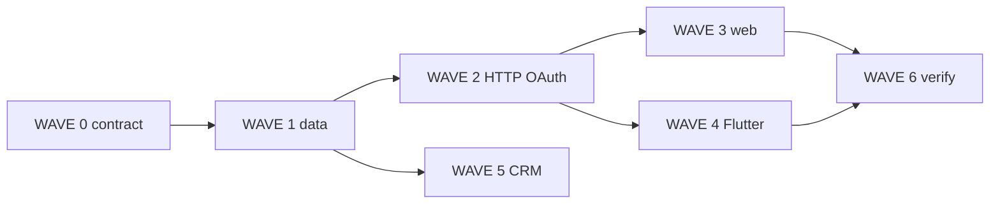

# Site guest member portal — multitask plan

> **For agentic workers:** REQUIRED SUB-SKILL: Use `subagent-driven-development` or `executing-plans`. One **Task subagent per track** in each wave; parent dispatches parallel tracks, does not implement all lanes inline. Subagent **model: inherit** (see `.cursor/rules/subagent-model.mdc`). Steps use checkbox (`- [ ]`) syntax.

**Goal:** Ship a **customer-facing member portal** on **published web** (`site-guest.v1.js` + Rust HTML) and **Flutter** (`GuestSiteView`, editor preview, in-app site visit) — sign-in with Alien, account chip, server-backed **my orders**, optional **member-only** SiteDoc pages — distinct from **staff** Team (`identity_grant`).

**Architecture:** New capability **`member_portal`** (on when `commerce` is on; site owner can disable). Logged-in shoppers use the normal **`ai.auth_session` JWT** (same Google OAuth as the app). Guest HTTP routes validate JWT + bind **`site.customer`** `(site_iid, user_iid) → contact_id`. Anonymous **`visitor_id`** still works; on login, **merge** local `order_ids` and analytics visitor into the account. Orders list reads **`site.tx`** where `input_source = web` and `tx_data_json.guest.buyer_user_iid` matches (set on put when `Authorization` present). **Dual renderer:** extend **`site.boot_get` / `__SITE_GUEST__`** with `member_portal` flags + signed-in profile snippet; one JS module `c35GuestMember`, one Dart `guest_site_member.dart`. Do **not** reuse `identity_grant role=guest` for shoppers (that is staff read-only).

**Tech stack:** Rust `c35_mod_site`, `c35_mod_tx`, `c35_mod_identity` (OAuth reuse), `wire_http`; protos `site.proto`, `tx.proto`; static `clients/web/static/site-guest/`; Flutter `clients/app/lib/guest_site/`.

**Specs (read first):** [`spec.md`](../../spec.md) · [`_/specs/site.md`](../site.md) · [`_/specs/tx.md`](../tx.md) · [`_/specs/auth.md`](../auth.md) · [`_/specs/site-guest-components.md`](../site-guest-components.md)

**Prior art:** Anonymous v1 in [`2026-10-08-site-guest-csa-commerce-parity-multitask.md`](2026-10-08-site-guest-csa-commerce-parity-multitask.md) Wave 5 (partial — `GuestSiteMemberStore`, `c35GuestOrders` alert). Preview **mock** tab in `ui_site_preview_card.dart` — replace with real portal.

---

## Current state (locked audit)

| Surface | Have today | Missing for portal |
|---------|------------|-------------------|
| **Web guest** | `visitor_id`, `c35GuestOrders` chip, `localStorage` orders, `guest-order/get` poll | Sign-in UI, OAuth return to site, `guest-order/list`, portal sheet (not `alert`), member-only page gate |
| **Flutter guest** | `GuestSiteMemberStore`, `GuestSiteOrdersChip`, cart checkout | OAuth on guest surface, server order list, hub **Member** tab, wire preview mock |
| **Server** | `guest-order/put`, `guest-order/get`; optional `Authorization` on guest-assistant only | `site.customer` row, list/merge APIs, persist `buyer_user_iid`, boot `member` slice |
| **CRM** | `site.contact` staff-side | Auto-link / upsert contact on member sign-in & checkout |
| **Staff “guest” grant** | Team role `guest` | **Out of scope** — not the customer portal |

---

## Global constraints

- Money path unchanged: **`POST /v1/site/guest-order/put`** / **`ReqSiteGuestOrderPut`**; list is **read-only** new route.
- No provider web grounding; no Alpine.js; single `site-guest.v1.js` (+ existing effects bundle).
- Guest order **put** stays **published-site only** unless existing draft-checkout token path is used (preview).
- CORS on new routes: same allowlist as `guest-assistant` (`api.alienai.id`, `alienai.id`, localhost dev).
- UTF-8 sources; verify per [`verify-after-edit.mdc`](../../.cursor/rules/verify-after-edit.mdc).
- Ship server: `.\_\scripts\deploy\publish_server.ps1`; bump guest static + republish sites when `site-guest.v1.js` changes.

---

## Locked design contract

1. **Capability:** `site.config.capabilities_json.member_portal` (bool). Default **true** when `commerce` is true; when false, hide portal chrome and treat all pages as public.
2. **Customer row:** `site.customer (site_iid, user_iid PK, contact_id, created_ts, updated_ts, deleted_ts)` — one Alien user per site membership.
3. **Tx linkage:** On authenticated guest put, set `tx_data_json.guest.buyer_user_iid`, `guest.visitor_id` (if sent), and `subject_contact_id` when contact resolved.
4. **List filter:** `guest-order/list` returns txs for `site_iid` + caller `user_iid` from JWT, `input_source = web`, newest first, cap 50 — **no** staff fields in JSON view model (reuse guest get sanitizer).
5. **Merge:** `POST /v1/site/guest-member/merge` with `{ site_iid, visitor_id, order_ids[] }` — attach orphan web txs (by id + proof: tx still has matching `guest.visitor_id` or was in anonymous local list) to `buyer_user_iid`.
6. **Member-only content:** `SitePage.audience` enum `public | members` (proto + `mod_site::doc` validation). Render + boot omit gated pages from public nav; direct URL returns **sign-in gate** HTML/Flutter route.
7. **Sign-in UX:** Hub profile chip → **Masuk** opens OAuth with `return_to=/{alien_id}/member` (or current path). Web stores JWT in **`localStorage` `c35.guest.auth.v1.{site_iid}`** (not HttpOnly cookie on alienai.id — API is cross-origin). Flutter uses existing app session when user already signed in; else in-app OAuth or deep link to system browser + poll `oauth_result` (same pattern as app auth).
8. **Naming:** Product copy **Member** / **Akun** / **Pesanan saya** — not “staff” or Team.

---

## File map

| Area | Files |
|------|--------|
| Schema | `_/schemas/site.sql`, migration `_/schemas/migrations/20261014_site_customer_v1.sql` |
| Proto | `_/schemas/proto/c35/site.proto` (`SitePage.audience`, `ReqSiteGuestMember*`, `ReqSiteGuestOrderList`) |
| Site module | `servers/crates/mod_site/src/site_customer.rs`, `site_boot.rs`, `render.rs`, `doc.rs` |
| Tx | `servers/crates/mod_tx/src/guest_order.rs`, `guest_order_list.rs` |
| HTTP | `servers/crates/wire_http/src/guest_member.rs`, `guest_order.rs` (list), extend CORS |
| Identity | Reuse `mod_identity::auth_oauth` return paths for guest URLs |
| Web JS | `clients/web/static/site-guest/src/site-guest.v1.js` (`c35GuestMember`), CSS hub chip |
| Flutter | `clients/app/lib/guest_site/guest_site_member.dart`, `guest_member_api.dart`, hub nav in `guest_site_blocks.dart` / `guest_site_view.dart`, `ui_site_preview_card.dart` |
| Editor | `site.config` capabilities toggle; optional Design hint for `audience: members` on pages |
| Docs | `_/specs/site.md`, `_/specs/site-guest-components.md`, `_/docs/en/` + `_/docs/id/` short guide `path: both` |
| Tests | `mod_site` doc/render tests, `guest_order_list` unit, `guest_site_member_test.dart`, render snapshot for gate page |

---

## Multitask map

```
WAVE 0  Spec + proto + capability (docs lock)
WAVE 1  Data model + guest-order put linkage + list API
WAVE 2  guest-member HTTP (session/me/merge) + OAuth return_to guest URLs
WAVE 3  Web renderer — c35GuestMember, portal sheet, page audience gate
WAVE 4  Flutter — GuestSiteMember portal, preview card, in-app visit
WAVE 5  CRM link (contact upsert) + inst/tool optional
WAVE 6  Verification, publish, manual E2E
```

---

## WAVE 0 — Contract (parallel)

### Track 0A — Specs

- [ ] **0A.1** Add **Guest member portal** section to [`_/specs/site.md`](../site.md): capability, `site.customer`, OAuth, distinction from staff grants.
- [ ] **0A.2** Extend [`_/specs/site-guest-components.md`](../site-guest-components.md): chrome row `member_portal`, boot keys `member_portal_enabled`, `member_profile`, `pages[]` audience.
- [ ] **0A.3** [`_/specs/tx.md`](../tx.md): document `tx_data_json.guest.*` for web checkout.
- [ ] **0A.4** User guide stub: `_/docs/en/sites/member-portal.md`, `_/docs/id/sites/member-portal.md` (`path: both`).

### Track 0B — Proto

- [ ] **0B.1** `SitePage`: field `audience` (`public` default | `members`).
- [ ] **0B.2** `ReqSiteGuestOrderList` / `ResSiteGuestOrderList` (summary rows: `tx_id`, `state`, `total`, `time_ts_ms`, `progress_label`).
- [ ] **0B.3** `ReqSiteGuestMemberMe` / `ResSiteGuestMemberMe` (`user_iid`, `display_name`, `pic`, `contact_id`).
- [ ] **0B.4** `ReqSiteGuestMemberMerge` — visitor + order_ids.
- [ ] **0B.5** Regenerate / sync Dart + Rust proto crates per repo script.

### Track 0C — Capability flag

- [ ] **0C.1** `site_config.rs`: parse `member_portal`; default on when `commerce` on.
- [ ] **0C.2** Sites editor **Capabilities** pane: toggle **Member portal** with subtitle (customer sign-in & order history).
- [ ] **0C.3** `site_boot.rs`: emit `member_portal_enabled` + filtered `pages` list for nav.

---

## WAVE 1 — Server data + orders (parallel)

### Track 1A — `site.customer`

- [ ] **1A.1** Migration + `site.sql` table `site.customer`.
- [ ] **1A.2** `site_customer_upsert(site_iid, user_iid) → contact_id` (create minimal `site.contact` from identity profile if missing).
- [ ] **1A.3** `site_customer_get` for boot/me.

### Track 1B — Guest order linkage

- [ ] **1B.1** `guest_order_put`: if `Authorization` valid, resolve `user_iid`, upsert customer, set `tx_data_json.guest.buyer_user_iid`, optional `visitor_id` from body/header.
- [ ] **1B.2** `guest_order_get`: allow fetch if tx is web AND (public tx_id + visitor proof **or** buyer matches JWT **or** staff grant) — tighten from today’s overly open get if needed.
- [ ] **1B.3** `guest_order_list`: JWT required; query by `buyer_user_iid`; integration test with seed tx.

### Track 1C — Merge

- [ ] **1C.1** `guest_member_merge`: for each `tx_id`, verify web source + (`visitor_id` match OR id in client list with matching stored guest meta); set `buyer_user_iid`.
- [ ] **1C.2** Rate-limit merge (per IP + user).

---

## WAVE 2 — HTTP + OAuth (parallel)

### Track 2A — Routes

- [ ] **2A.1** `POST /v1/site/guest-member/me` (JWT).
- [ ] **2A.2** `POST /v1/site/guest-member/merge` (JWT + body).
- [ ] **2A.3** `POST /v1/site/guest-order/list` (JWT).
- [ ] **2A.4** Wire into `wire_http` router + JSON/proto dual encoding like other guest routes.

### Track 2B — OAuth return to guest site

- [ ] **2B.1** Allow `return_to` paths under `https://alienai.id/{alien_id}/**` and verified custom domains (reuse domain → site resolve).
- [ ] **2B.2** Document web flow: open `GET /v1/auth/google?return_to=...&client_id=...` from guest JS; poll or redirect handler writes token to `localStorage`.
- [ ] **2B.3** Flutter: if `sessionAuthToken()` non-empty, skip OAuth; else launch auth with guest `return_to` or embedded sign-in sheet.

### Track 2C — Boot auth snippet

- [ ] **2C.1** Optional `POST` boot enrichment is **not** used — client calls `/guest-member/me` after load when token present.
- [ ] **2C.2** `__SITE_GUEST__.member_portal_enabled` boolean in `render.rs` inline JSON.

---

## WAVE 3 — Web renderer (parallel)

### Track 3A — `c35GuestMember`

- [ ] **3A.1** Token read/write `c35.guest.auth.v1.{site_iid}`; sign-out clears token + optional visitor retain.
- [ ] **3A.2** Hub chip: signed out → **Masuk**; signed in → avatar + **Pesanan saya**.
- [ ] **3A.3** Portal sheet: profile row, order list from API, tap → existing progress stepper (`c35GuestOrder.poll`).
- [ ] **3A.4** On login success: call merge with `visitor_id` + `loadOrders()` ids; refresh chip.

### Track 3B — Replace `c35GuestOrders` alert UX

- [ ] **3B.1** Delegate `c35GuestOrders.open()` to `c35GuestMember.openOrders()` (sheet).
- [ ] **3B.2** Keep anonymous localStorage fallback when logged out.

### Track 3C — Member-only pages

- [ ] **3C.1** `page_html_render`: if `audience == members` and no JWT in request (cookie query `?member_token=` **not** used — client-side only for v1), render gate page with sign-in CTA (prerender shell).
- [ ] **3C.2** JS: on member routes, if no token, show gate overlay; if token, fetch page content via **new** `GET /v1/site/guest-page/get?path=` (authenticated) **or** SSR with edge token — **pick one in 3C design note:** prefer **`guest-page/get`** JSON for gated doc slice to avoid caching public HTML of private content.
- [ ] **3C.3** Hub nav hides member pages when logged out (boot lists `nav_pages` with `audience`).

### Track 3D — CSS + render hub

- [ ] **3D.1** Port CSA-style hub tab **Member** / **Akun** (third tab beside shop/posts) when `member_portal_enabled`.
- [ ] **3D.2** `site-guest.v1.css` chip + sheet styles; run `clients/web/static/site-guest/build.ps1`.

---

## WAVE 4 — Flutter (parallel)

### Track 4A — API + state

- [ ] **4A.1** `guest_member_api.dart`: me, list, merge (Bearer from `sessionAuthToken()` or guest-local token store for webview visit).
- [ ] **4A.2** `GuestSiteMemberController` — login state, orders, merge on login.

### Track 4B — UI

- [ ] **4B.1** `guest_site_member.dart`: portal sheet (parity with web).
- [ ] **4B.2** Hub third tab **Member** in `GuestSiteView` when capability on (replace mock in `ui_site_preview_card.dart` with shared widget).
- [ ] **4B.3** Member-only `SitePage` route in preview navigator — gate when logged out.
- [ ] **4B.4** `GuestSiteOrdersChip` → open portal orders section; after checkout still save local + refresh list if logged in.

### Track 4C — Sign-in

- [ ] **4C.1** In-app preview: use existing session (99000 testing).
- [ ] **4C.2** External browser visit (`openSite`): document that user must sign in via web OAuth unless app session shared (future: universal link) — v1 **web OAuth only** on external browser.

---

## WAVE 5 — CRM + prompt (parallel, can defer partially)

### Track 5A — Contact link

- [ ] **5A.1** On customer upsert, match `site.contact` by email/phone; else insert `source: member_portal`.
- [ ] **5A.2** Staff UITable Contacts shows linked Alien handle in `meta_json.linked_alien_id` (read-only).

### Track 5B — Prompt (optional v1.1)

- [ ] **5B.1** `inst.site.member` readonly: “how many members”, “orders for @contact” via `site.query.run` — **defer** if query defs not ready.

---

## WAVE 6 — Verification & ship

### Track 6A — Automated

```powershell
cd servers
cargo test -p c35_mod_site
cargo test -p c35_mod_tx
cargo build -p server_ai
.\_\scripts\dev\check_utf8_sources.ps1 -Changed -Fix
cd ..\clients\app
.\_\scripts\dev\verify_flutter_app.ps1
flutter test test/guest_site_member_test.dart test/guest_site_cart_test.dart
cd ..\clients\web\static\site-guest
.\build.ps1
```

### Track 6B — Manual E2E

- [ ] **6B.1** Published commerce site: anonymous order → chip → login → merge → list shows order → progress stepper.
- [ ] **6B.2** Member-only page: logged out → gate; logged in → content.
- [ ] **6B.3** Flutter preview: same flows in **Published** mode.
- [ ] **6B.4** Second device login: list shows merged orders without localStorage.

---

## Out of scope (v1)

- Subscriptions, tiers, points, paid membership fees.
- Magic-link / phone OTP (OAuth only v1).
- Staff `identity_grant role=guest` changes.
- Full social network / CSA `mod_social` follow graph.
- Cross-site single sign-on (portal is **per site_iid**).

## v2 backlog

- Email magic link for users without Google.
- Wallet / store credit tied to `site.contact`.
- Push notify member when order state changes (FCM + `buyer_user_iid`).
- `guest-page/get` CDN caching with short-lived JWT.

---

## Dependency graph



**Parallel dispatch:** After W0, run W1; after W2, run **W3 + W4 + W5** in parallel; finish W6.
