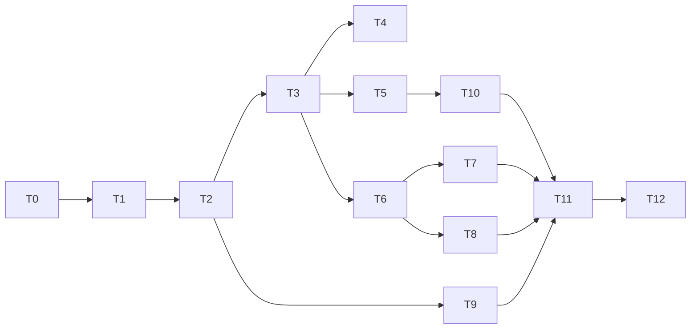

# Site guest queue (antrian) — CSA parity multitask plan

> **For agentic workers:** REQUIRED SUB-SKILL: Use `subagent-driven-development` or `executing-plans` task-by-task. Subagent model: **inherit** (`.cursor/rules/subagent-model.mdc`). Steps use checkbox (`- [ ]`) syntax.

**Goal:** Bring c35 **guest waiting-room queue** (`capabilities_json.queue`) to functional parity with `D:\csa_site_published` (`mod_site_queue` + guest site + staff operator). **Explicitly not** POS / kitchen `order_fulfillment` (`pos_queue`).

**Architecture:** Evolve `site.queue` / `site.queue_ticket` toward CSA’s **run + ticket lifecycle** model (open run per counter, ticket statuses, `track_token`). Keep c35 patterns: `site_iid`, `identity_grant` staff ACL, HTTP guest APIs under `wire_http`, Flutter site editor + `GuestSiteView`, web `site-guest.v1.js`. Queue definitions appear in **publish boot** (like products); live tickets/board are **server-only** (no republish per take).

**Tech stack:** Rust `c35_mod_site` + `wire_http` + optional `wire_ws`, YB migrations in `_/schemas/`, protobuf `site.proto` / `wire.proto`, Flutter `clients/app`, static `clients/web/static/site-guest/`.

**CSA references (read-only):**

| Area | Path |
|------|------|
| Schema | `D:\csa_site_published\_\schemas\site_queue.sql` |
| Server | `D:\csa_site_published\crates\mod_site_queue\src\service.rs` |
| Guest UX | `D:\csa_site_published\client\site\src\main.ts` (queue flows in Alpine cart — compare behaviors, not stack) |
| Merchant editor | `D:\csa_site_published\clients\app\lib\widgets\site\ui_site_queue_section.dart` |
| Staff operator | `D:\csa_site_published\clients\app\lib\widgets\staff\ui_staff_queue_operator.dart` |
| Product doc | `D:\csa_site_published\_\docs\site\queue.md` |

**c35 today (minimal):**

| Piece | Status |
|-------|--------|
| `site.queue` + `site.queue_ticket` | Counters on queue row; ticket `waiting` only |
| `guest_queue_take/get` | Take increments `last_ticket_no`; no form fields, no `track_token` |
| `site_queue_advance` | `serving_ticket_no++` only — not tied to tickets |
| `UiSiteQueueEditor` | Single queue, call-next only |
| Guest block + JS | One button; localStorage `ticket_id` only |
| Staff home queue board | **Missing** |
| Multi-queue admin UI | **Missing** |
| Publish boot `queues[]` | **Missing** (block props only) |

---

## Global constraints

- Capability: `site.config.capabilities_json.queue` — gate guest take and editor nav (existing).
- Do **not** conflate with `order_fulfillment` / `pos_queue` (`_/specs/site.md`).
- Staff auth: `site_grant_check` / staff+ on WS; no CSA `site_member`.
- Guest take: published site only (`site_published`), same as today.
- UTF-8 sources; verify per `verify-after-edit.mdc` (`cargo test -p c35_mod_site`, `flutter test`, `check_utf8_sources.ps1 -Changed -Fix`).
- Prompt-first: optional `inst.site.queue` seed for enable/configure (mirror `inst.site.reservation`).
- Do not commit unless the user asks.

---

## Target behavior (acceptance)

1. Merchant can create **multiple** queues (name, prefix, color/icon, sort, active, take-online, reset policy daily/manual, guest **fields** JSON like forms).
2. Guest on published site: pick queue (block or `/queue/...` route if spec’d), fill required fields, **take number** → display label e.g. `A-042` + **track link** (token).
3. Guest track page polls **position / now serving / status** without staff login.
4. Staff: **board** per queue (now serving, waiting preview), **call next**, **recall**, mark **serving / done / skip**, **manual reset** (new run).
5. Daily reset closes run and opens new run at configured local time (lazy check on take/board OK for v1).
6. Migrate existing minimal rows: one default queue + tickets map to first open run where possible.

---

## Multitask map (waves)

Execute **one Task per subagent** within a wave; waves are sequential.

| Wave | Tasks | Outcome |
|------|-------|---------|
| **W0** | T0 Spec + schema design sign-off | Locked ERD + proto sketch in this file |
| **W1** | T1 Migration, T2 Proto, T3 Core Rust (`site_queue` refactor) | DB + unit tests for run/take/overlap |
| **W2** | T4 Guest HTTP, T5 Staff WS/HTTP | Public track + staff board APIs |
| **W3** | T6 Publish boot, T7 Web guest, T8 Flutter guest | Parity with `site-guest-components.md` |
| **W4** | T9 Merchant queue editor, T10 Staff operator UI | CSA-like admin + call-next board |
| **W5** | T11 Inst/docs, T12 E2E checklist | Shippable + verify script notes |

**Out of scope (separate plan):** Work-shift **clock-in**, payroll, staff `inWorkShift` feed — see `_/specs/site.md` “clock-in deferred”. Optional follow-up: `2026-10-14-site-attendance-runtime-multitask.md`.

---

## Task list (implementation units)

### T0 — Spec lock (no code)

- [ ] Update `_/specs/site.md` + `_/specs/site-guest-components.md` with queue boot fields, ticket statuses, track URL shape, RPC table.
- [ ] Confirm migration strategy: add `site.queue_run`; extend `site.queue` columns vs `meta_json` (prefer **columns** for `prefix`, `take_online`, `reset_policy`, `fields`, `sort_order`; keep color/icon in `meta_json` if needed).

### T1 — Schema migration

- [ ] New migration: `site.queue_run` (CSA-shaped: `run_id`, `queue_id`, `next_number`, `serving_number`, `status`, `reset_*`, timestamps).
- [ ] Alter `site.queue`: `description`, `fields` JSONB, `take_online`, `reset_policy` JSONB, `sort_order`, `color`/`icon` or document meta keys; deprecate reliance on `last_ticket_no` / `serving_ticket_no` on queue row (keep for backward compat one release or migrate into open run).
- [ ] Alter `site.queue_ticket`: `run_id`, `track_token` (unique), `display_label`, `answers` JSONB, status enum (`waiting`, `called`, `serving`, `done`, `skipped`, `cancelled`), `called_at`, `done_at`; index `(site_iid, queue_id, run_id, status)`.
- [ ] Backfill: create open run per queue; attach orphan tickets.

### T2 — Protobuf + wire

- [ ] Extend `SiteQueue` in `_/schemas/proto/c35/site.proto` (fields, policies, display).
- [ ] Add messages: `QueueBoard`, `QueueTicket`, `Req/Res` for `queue_board`, `queue_call_next`, `queue_ticket_set_status`, `queue_reset`, `queue_ticket_list` (staff).
- [ ] Guest: `ReqGuestQueueTake` with `answers_json`; `ResGuestQueueTake` with `display_label`, `track_token`; `ReqGuestQueueTrack` by token.
- [ ] Regenerate Dart/Rust via `._\scripts\protoc.ps1`; wire WS opcodes in `wire.proto`.

### T3 — Core Rust (`site_queue.rs` split)

- [ ] Module layout: `site_queue/mod.rs`, `run.rs`, `ticket.rs`, `guest.rs`, `staff.rs` (or equivalent — keep files focused).
- [ ] `ensure_open_run` + daily reset from `reset_policy` (timezone from site config or `Asia/Jakarta` default).
- [ ] `guest_queue_take`: validate fields schema, allocate ticket number from run, generate `track_token`, set `display_label` = prefix + number.
- [ ] `guest_queue_track`: token → ticket + board snapshot (position estimate).
- [ ] `queue_call_next`: `FOR UPDATE SKIP LOCKED` oldest `waiting` → `called`, update run `serving_number` (port CSA SQL).
- [ ] `ticket_set_status`, `board_build`, `manual_reset`.
- [ ] Remove or shim old `site_queue_advance` to call `call_next` internally.
- [ ] Tests: `servers/crates/mod_site/tests/queue_*` — reset boundary, call-next ordering, take when run closed, inactive queue, capability off.

### T4 — Guest HTTP (`wire_http/src/guest_queue.rs`)

- [ ] `POST /v1/site/guest-queue/take` — accept `answers` + field validation errors.
- [ ] `GET /v1/site/guest-queue/track?track_token=…` (or POST body) — polling JSON.
- [ ] Optional: dedicated track page route in `mod_site` render (`/q/{token}`) serving minimal HTML + same JS poll.
- [ ] Rate limit / captcha hook if cluster already has guest-order pattern (reuse fetcher captcha plan only if required).

### T5 — Staff APIs

- [ ] WS handlers (preferred for app): `site.queue.board`, `site.queue.call_next`, `site.queue.ticket.set_status`, `site.queue.reset`, `site.queue.ticket.list`.
- [ ] Grant: staff read board; manage for status/reset.
- [ ] List queues in `site.editor.warm` / `SiteApi.queueList` unchanged contract but multi-row.

### T6 — Publish + boot

- [ ] Include active queues in commerce/site boot JSON (`queues[]`: id, name, prefix, fields, take_online, color, icon) when `queue` cap on.
- [ ] `render.rs` queue block: data attributes for fields; link to track after take.
- [ ] Snapshot/version: queue **definitions** only (not tickets).

### T7 — Web guest (`site-guest.v1.js` + css)

- [ ] Queue sheet: dynamic form from boot fields (mirror contact form patterns).
- [ ] After take: show label + copy track URL; poll track endpoint.
- [ ] Multi-queue: block `queue_id` or listing page if boot has many.

### T8 — Flutter guest (`guest_site_blocks.dart`, tests)

- [ ] `GuestSiteQueueBlock`: field form, take API, track state, `guest_site_view_test.dart` cases.
- [ ] Match web boot contract.

### T9 — Merchant editor (`ui_site_queue_editor.dart` → full section)

- [ ] Port CSA behaviors: list, search, add queue, detail (prefix, fields builder, reset policy, take online, color/icon), delete/archive.
- [ ] Master/detail like products; catalog cache `setQueues` multi.
- [ ] Deep link: site doc block picker lists queues from catalog.

### T10 — Staff operator UI

- [ ] New widget (e.g. `ui_site_queue_operator.dart`) reachable from Sites → Queue or staff site home when user has grant.
- [ ] Board UI: now serving, waiting list, actions call next / skip / done / recall.
- [ ] Wire to T5 RPCs; loading/error states.

### T11 — Inst + docs

- [x] `inst.site.queue` in `_/schemas/inst.sql` + live `inst_put` note in plan.
- [x] `_/docs/en|id/sites/guest-queue.md`
- [ ] User guides `_/docs/en|id/` queue article (prompt-first take + staff call-next).
- [ ] Update this plan **Status** table when each task lands.

### T12 — Verification checklist

```powershell
cd servers
cargo test -p c35_mod_site
cargo build -p server_ai
cd ..\clients\app
flutter test test/guest_site_view_test.dart
# add test/queue_* when added
.\_\scripts\dev\check_utf8_sources.ps1 -Changed -Fix
```

Manual: publish site with queue cap → web take → second browser track → staff call next → guest status updates.

---

## Dependency graph



---

## Risk / decisions (resolve in T0)

| Topic | Recommendation |
|-------|----------------|
| Ticket ID vs token | Public track uses **opaque `track_token`**; `ticket_id` stays internal/snowflake. |
| Queue ID type | Keep `int64 queue_id` (c35); CSA string ids — no need to change. |
| Realtime | v1 **HTTP poll** (5–10s); NATS push later if needed. |
| Form fields | Reuse contact-form field shape from `site.form` types in JSON schema doc. |
| Legacy API | Keep `guest-queue/get` by `ticket_id` for localStorage compat; prefer token for share links. |

---

## Status

| Task | State |
|------|-------|
| T0 | partial — plan + `site-guest-components.md` touch |
| T1–T5 | **done** — migration, proto, `queue_csa.rs`, HTTP/WS |
| T6–T8 | **done** — boot, render, web JS, Flutter guest sheet |
| T9–T10 | **done** — multi-queue editor + operator (WS wired) |
| T11 | **done** — inst + user docs |
| T12 | **partial** — `cargo test -p c35_mod_site`, `flutter test guest_site_view_test` OK; apply DB migration before prod |
